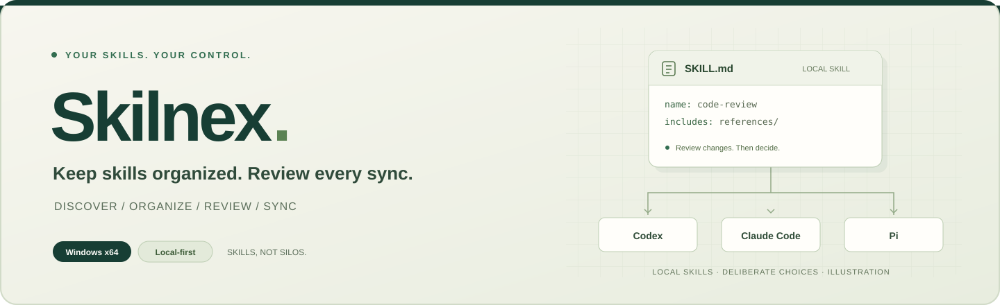

<p align="center">
  <a href="https://liutouo.github.io/Skilnex-releases/en/">
    
  </a>
</p>

<p align="center">
  
</p>

<h1 align="center">Skilnex</h1>

<p align="center">
  <strong>Keep your agent skills organized. Review every sync.</strong>
</p>

<p align="center">
  A local Agent Skills inventory and sync tool for Windows.<br>
  Read and organize in one place. Review changes before you copy.
</p>

<p align="center">
  <a href="https://github.com/LiuTouo/Skilnex-releases/releases/latest"></a>
  <a href="https://github.com/LiuTouo/Skilnex-releases/actions/workflows/pages.yml"></a>
  <a href="#get-started"></a>
  <a href="#data-and-operation-boundaries"></a>
</p>

<p align="center">
  <a href="https://github.com/LiuTouo/Skilnex-releases/releases/latest"><strong>Download for Windows</strong></a>
  &nbsp; · &nbsp;
  <a href="https://liutouo.github.io/Skilnex-releases/en/"><strong>Product website</strong></a>
  &nbsp; · &nbsp;
  <a href="https://liutouo.github.io/Skilnex-releases/en/#demo"><strong>Interactive demo</strong></a>
  &nbsp; · &nbsp;
  <a href="README.md">繁體中文</a>
</p>

<p align="center">
  <a href="#what-can-you-do">Features</a> ·
  <a href="#get-started">Get started</a> ·
  <a href="#data-and-operation-boundaries">Boundaries</a> ·
  <a href="#for-a-closer-look-at-the-engineering">Engineering</a>
</p>

---

## Who is it for?

Keep working with the agents you know. Let Skilnex bring clarity to the skills around them.

| Find the source | Keep things organized | Sync with confidence |
| :--- | :--- | :--- |
| You use several agents and want to know where each skill lives and where it came from. | Your collection needs search, groups, favorites, and notes—not more folder hunting. | You want to reuse skills in another agent while staying in control of local changes. |

> Skilnex manages **the skill files and supporting content that agents read**. It is not a chat interface and does not execute skills on an agent's behalf.

## What can you do?

| Capability | What it means for you |
| :--- | :--- |
| **Inventory & discovery** | See sources, agents, global/project locations, and multiple instances; identify shared paths. |
| **Reading & organization** | Search full text, read `SKILL.md` and attachments, and add favorites, notes, and custom groups. |
| **Preview & sync** | Choose a local source and targets, preview changes across the folder, then confirm a one-way copy. |
| **Conflicts & recovery** | Explicitly approve replacing modified targets; changes after preview block execution; replacements preserve a recoverable copy. |
| **MCP configuration** | Read existing configurations and agent associations in supported formats. No server startup or configuration writes. |
| **Prompt management** | Categorize, tag, favorite, and copy prompts, with JSON import/export. |

### Agent integrations

<p align="center">
  <code>Codex</code> &nbsp; <code>Claude Code</code> &nbsp; <code>OpenCode</code> &nbsp; <code>Pi</code> &nbsp; <code>Hermes</code> &nbsp; <code>OpenClaw</code>
</p>

Built-in skill discovery and inventory adapters cover these six products. You can also register extra instances and custom skill directories.

An adapter does not certify every version, loading rule, or runtime environment. Location and availability indicators are **static checks** of supported conditions, not proof that a skill runs successfully. MCP format support also varies by product.

## Get started

### 01 · Choose a download

Open the **[latest Release](https://github.com/LiuTouo/Skilnex-releases/releases/latest)** and select an asset:

| Windows installer | Portable edition |
| :--- | :--- |
| Download `*_x64-setup.exe` and follow the installer. | Extract the entire `*-windows-x64-portable.zip`, then run `Skilnex.exe`. |
| App data lives in your user-local application data directory. | Keep `portable.flag` and `data` with the app when moving it. |

**Requirements: Windows x64 and Microsoft WebView2 Runtime.** The installer can download WebView2 if it is missing; the portable version also requires the Runtime. You do not need Node.js, Rust, or development tools.

If Windows or an organization policy blocks execution, verify the download source and follow your administrator's policy. Disabling security protections is not recommended.

### 02 · Scan and read

Launch Skilnex and scan your local agents. Add Git projects or custom skill directories as needed. Open a skill to inspect its source, content, and attachments.

### 03 · Preview and confirm

In the skill's inspection/sync view, select a local source and destination agents. Review the file differences before confirming; replacing an already modified target requires separate approval. Afterwards, use the operation log in Settings to review records and available recovery actions.

> **Try it before downloading.** [Explore the interactive sync walkthrough](https://liutouo.github.io/Skilnex-releases/en/#demo). The website uses fictional data only: it does not read or write local files, connect to agents, or call a model.

## Data and operation boundaries

- **Review first, decide second.** No automatic background sync, and a missing source does not automatically delete its targets.
- **You or the original agent still maintain the skills.** No upstream update checks for external skill copies or in-place updates.
- **No arbitrary takeover of other tools' files.** Package-managed, plugin, built-in, and linked directories are not sync overwrite targets. Package-manager lockfiles are not modified.
- **Static hints are not security guarantees.** Manifest, structure, link, and command checks are not runtime verification or cross-agent compatibility certification.
- **Local-first is not the same as fully offline.** Local inventory, reading, and sync operate on local files; GitHub imports, downloads, version checks, and app updates may require a network connection.
- **Recovery checks the current state too.** External changes can block recovery. Sensitive configuration fields are redacted in backups, so reauthentication may be necessary after a restore.

Downloads currently target **Windows x64**. No support is claimed for macOS, Linux, remote/WSL environments, private skill sources, or third-party MCP extensions.

## For a closer look at the engineering

```text
React / TypeScript  →  Tauri 2 IPC  →  Rust  →  SQLite + local files
```

| Engineering area | Design focus |
| :--- | :--- |
| **Agent integrations** | Heterogeneous configurations and scopes, source attribution, and shared-path deduplication. |
| **Operation safeguards** | Content hashes, stale-preview checks, conflict confirmation, backups before replacement, and operation records. |
| **Verification & delivery** | The desktop project has Rust, Vitest, and Playwright tests, plus GitHub Actions validation, packaging, and release workflows. |

Tests do not mean every agent has passed live skill-execution testing. The **website checks** badge above represents checks for this public website only.

**[Read the engineering overview →](https://liutouo.github.io/Skilnex-releases/en/#engineering)**

## About this repository

This public repository provides **Windows releases, product information, and the website**. The desktop application's source code is not public. A public download does not imply an open-source or commercial-use license; this page does not add license terms, enterprise compliance claims, or an SLA.

---

<p align="center">
  <strong>Local skills. Deliberate choices.</strong><br><br>
  <a href="https://github.com/LiuTouo/Skilnex-releases/releases">All releases</a> ·
  <a href="https://github.com/LiuTouo">Author on GitHub</a> ·
  <a href="CONTRIBUTING.md">Website maintenance</a>
</p>
