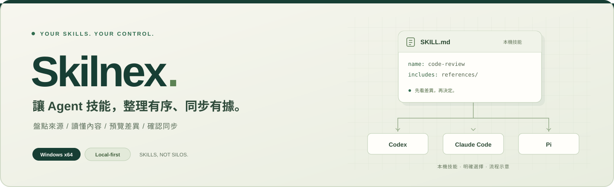

<p align="center">
  <a href="https://liutouo.github.io/Skilnex-releases/">
    
  </a>
</p>

<p align="center">
  
</p>

<h1 align="center">Skilnex</h1>

<p align="center">
  <strong>讓不同 AI Agent 的技能，整理有序、同步有據。</strong>
</p>

<p align="center">
  Windows 本機 Agent Skills 盤點與同步工具。<br>
  集中閱讀與整理技能，先看差異，再決定如何同步。
</p>

<p align="center">
  <a href="https://github.com/LiuTouo/Skilnex-releases/releases/latest"></a>
  <a href="https://github.com/LiuTouo/Skilnex-releases/actions/workflows/pages.yml"></a>
  <a href="#快速開始"></a>
  <a href="#資料與操作邊界"></a>
</p>

<p align="center">
  <a href="https://github.com/LiuTouo/Skilnex-releases/releases/latest"><strong>下載 Windows 版</strong></a>
  &nbsp; · &nbsp;
  <a href="https://liutouo.github.io/Skilnex-releases/"><strong>產品網站</strong></a>
  &nbsp; · &nbsp;
  <a href="https://liutouo.github.io/Skilnex-releases/#demo"><strong>互動示範</strong></a>
  &nbsp; · &nbsp;
  <a href="README.en.md">English</a>
</p>

<p align="center">
  <a href="#你可以做什麼">核心功能</a> ·
  <a href="#快速開始">快速開始</a> ·
  <a href="#資料與操作邊界">能力邊界</a> ·
  <a href="#給想了解工程設計的人">工程設計</a>
</p>

---

## 適合什麼情境？

你可以繼續使用熟悉的 Agent，讓 Skilnex 處理技能管理中容易混亂的部分。

| 找得到來源 | 整理得清楚 | 同步有依據 |
| :--- | :--- | :--- |
| 同時使用多種 Agent，想知道技能實際放在哪裡、來自哪個來源。 | 技能愈來愈多，需要搜尋、分組、收藏與筆記，不想一直翻資料夾。 | 想複用技能到另一個 Agent，同時保留對既有修改的控制權。 |

> Skilnex 管理的是 **Agent 會讀取的技能檔案與附帶內容**，不是 AI 聊天介面，也不會代替 Agent 執行技能。

## 你可以做什麼？

| 能力 | 使用方式 |
| :--- | :--- |
| **盤點與探索** | 查看技能來源、所在 Agent、全域／專案位置與多實例；辨識共享路徑。 |
| **閱讀與整理** | 全文搜尋、閱讀 `SKILL.md` 與附件，搭配收藏、筆記及自訂分組。 |
| **預覽與同步** | 選定本機來源與目標，預覽整個資料夾的檔案差異，再確認單向複製。 |
| **衝突與還原** | 修改過的目標需明確確認取代；預覽後變動會阻擋執行；取代前保存可還原副本。 |
| **MCP 設定盤點** | 讀取已支援格式中的既有配置與 Agent 關聯，不啟動 MCP 服務、不修改設定。 |
| **提示詞管理** | 分類、標籤、收藏與複製提示詞，支援 JSON 匯入／匯出。 |

### Agent 適配範圍

<p align="center">
  <code>Codex</code> &nbsp; <code>Claude Code</code> &nbsp; <code>OpenCode</code> &nbsp; <code>Pi</code> &nbsp; <code>Hermes</code> &nbsp; <code>OpenClaw</code>
</p>

內建以上六種產品的技能偵測與盤點適配，並可登記額外實例與自訂技能目錄。

適配不代表所有版本、載入規則或執行環境都已實機認證。位置與可用性標示是已支援條件的**靜態檢查**，不是技能執行成功的保證；MCP 格式的支援範圍也依產品而異。

## 快速開始

### 01 · 選擇下載方式

前往 **[最新 Release](https://github.com/LiuTouo/Skilnex-releases/releases/latest)**，在 Assets 選擇適合你的檔案：

| Windows 安裝版 | Portable 免安裝版 |
| :--- | :--- |
| 下載 `*_x64-setup.exe`，依指示安裝。 | 下載 `*-windows-x64-portable.zip`，完整解壓後執行 `Skilnex.exe`。 |
| 應用資料存放於使用者的本機應用資料目錄。 | 移動時一併保留 `portable.flag` 與 `data`。 |

**系統需求：Windows x64 與 Microsoft WebView2 Runtime。** 安裝程式可在缺少 WebView2 時下載安裝；免安裝版也需要這個 Runtime。一般使用者不需要 Node.js、Rust 或開發工具。

若 Windows 或公司端點政策阻擋執行，請先核對下載來源並依管理政策處理；不建議關閉安全保護。

### 02 · 掃描與閱讀

啟動 Skilnex，掃描本機 Agent；視需要加入 Git 專案或自訂技能目錄。開啟技能，檢查來源、內容及附件。

### 03 · 預覽與確認

在技能的「檢查／同步」選擇本機來源與目標 Agent。看過檔案差異後確認；若目標已有修改，必須另外同意取代。完成後，可在設定中的操作日誌查看紀錄與可用的還原操作。

> **先體驗，再下載。** [試一次互動同步流程](https://liutouo.github.io/Skilnex-releases/#demo)。網頁只使用虛構資料，不讀寫本機、不連接 Agent，也不呼叫模型。

## 資料與操作邊界

- **先看，再決定。** 不背景自動同步，也不因來源消失而自動刪除目標。
- **技能仍由你或原 Agent 維護。** 不提供外部技能副本的上游更新檢查或原地更新。
- **不任意接管其他工具的檔案。** 套件、外掛、內建技能及連結目錄不作為同步覆寫目標；不修改套件管理器鎖定檔。
- **靜態提示不是安全保證。** manifest、結構、連結及命令提示檢查，不等於執行驗證或跨 Agent 相容認證。
- **本機優先，不等於完全離線。** 本機盤點、閱讀與同步處理本機檔案；GitHub 匯入、下載與版本／應用更新功能可能需要連網。
- **還原也會檢查現況。** 外部變更可能阻擋還原，備份中的敏感設定會遮蔽，還原後可能需要重新認證。

目前下載提供 **Windows x64**；不宣稱 macOS、Linux、遠端／WSL、私人技能來源或第三方 MCP extension 的支援。

## 給想了解工程設計的人

```text
React / TypeScript  →  Tauri 2 IPC  →  Rust  →  SQLite + 本機檔案
```

| 工程面向 | 設計重點 |
| :--- | :--- |
| **Agent 整合** | 異質設定與作用域適配、來源辨識、共享目錄去重。 |
| **操作保護** | 內容雜湊、預覽失效檢查、衝突確認、取代前備份與操作紀錄。 |
| **驗證與交付** | 桌面專案有 Rust、Vitest、Playwright 測試，以及 GitHub Actions 驗證／封裝／發布流程。 |

測試不代表每種 Agent 都已通過實際技能執行驗證；上方 **website checks** 徽章只代表此公開網站的檢查狀態。

**[查看工程設計摘要 →](https://liutouo.github.io/Skilnex-releases/#engineering)**

## 關於這個 repository

此公開庫提供 **Windows 發行檔、產品介紹與網站**；Skilnex 桌面應用原始碼未公開。公開可下載不等於開源或已授予商用授權；本頁不新增授權條款、企業合規或 SLA 承諾。

---

<p align="center">
  <strong>本機技能。明確選擇。</strong><br><br>
  <a href="https://github.com/LiuTouo/Skilnex-releases/releases">所有版本</a> ·
  <a href="https://github.com/LiuTouo">作者 GitHub</a> ·
  <a href="CONTRIBUTING.md">網站維護說明</a>
</p>
